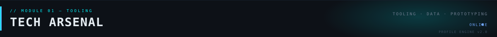
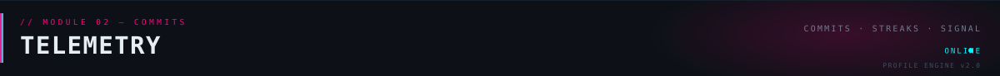
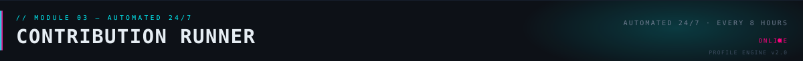

<!--
  ┌────────────────────────────────────────────────────────────────────────┐
  │  PROFILE ENGINE v2.1 · Tokyo Night / minimal footprint                 │
  │  Public data only: no private repositories, no hardware details.       │
  │  Automation: .github/workflows/profile-engine.yml (24/7 heartbeat)     │
  └────────────────────────────────────────────────────────────────────────┘
-->

 

 

  

  <b>Systems Engineering student at UNIMINUTO</b> 
  Interested in backend development, databases and IoT prototyping. 
  This profile is a live dashboard of my public GitHub activity.

<!-- ═══════════════════════════════ TECH ARSENAL ═══════════════════════════════ -->

  

<table align="center">
  <tr>
    <th align="center">▍BACKEND &amp; DATA</th>
    <th align="center">▍FRONTEND &amp; UI</th>
    <th align="center">▍HARDWARE, OS &amp; TOOLS</th>
  </tr>
  <tr valign="top">
    <td align="center">
        
      
      
      
        
      APIs · SQL · data modeling
    </td>
    <td align="center">
        
      
      
        
      HTML5 · CSS3 · responsive UI
    </td>
    <td align="center">
        
      
      
      
        
      Arduino · sensors · motor control
    </td>
  </tr>
</table>

<!-- ═══════════════════════════════ TELEMETRY ═══════════════════════════════ -->

  

  
  

 

  
   
  Only public GitHub data is displayed.

<!-- ═══════════════════════════════ 24/7 SNAKE ═══════════════════════════════ -->

  

  <picture>
    <source media="(prefers-color-scheme: dark)" srcset="https://raw.githubusercontent.com/nicolasmoncada160622-prog/nicolasmoncada160622-prog/output/github-contribution-grid-snake-dark.svg"/>
    <source media="(prefers-color-scheme: light)" srcset="https://raw.githubusercontent.com/nicolasmoncada160622-prog/nicolasmoncada160622-prog/output/github-contribution-grid-snake.svg"/>
    
  </picture>

<!-- ═══════════════════════════════ FOOTER ═══════════════════════════════ -->

 

  

  <!-- LAST_ACTIVE_START -->⚡ <b>Sistema Activo</b> | Última sincronización automática: <code>2026-11-18 15:00:17 COT</code><!-- LAST_ACTIVE_END -->
    
  Bogotá, Colombia · <code>profile-engine v2.1</code> · public data only

