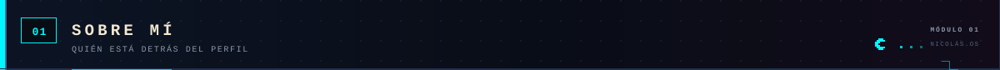
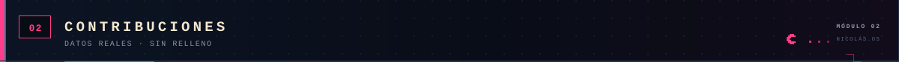
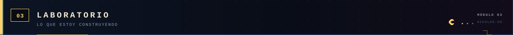
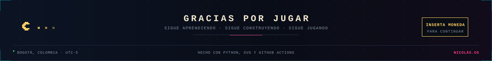

<!--
  ┌────────────────────────────────────────────────────────────────────────┐
  │  PROFILE ENGINE · Pixel / Arcade edition                               │
  │  Todo el arte se genera con Python + SVG. Cero plantillas externas.    │
  │  Datos 100% públicos de GitHub. Sin métricas inventadas.               │
  │  Automatización: .github/workflows/profile-engine.yml                  │
  └────────────────────────────────────────────────────────────────────────┘
-->

  

  
    <a href="#sobre-mi">SOBRE MÍ</a> &nbsp;·&nbsp;
    <a href="#contribuciones">CONTRIBUCIONES</a> &nbsp;·&nbsp;
    <a href="#laboratorio">LABORATORIO</a>
  

  

Tengo 20 años, vivo en Bogotá y estudio **Ingeniería de Sistemas** en **UNIMINUTO** (3er semestre). Me interesa la **IA** —la uso a diario en un nivel intermedio— y el **vibe coding** como una forma de mejorar mi flujo de desarrollo sin saltarme los fundamentos. También me atrae la **ciberseguridad**, el **diseño** y la **creatividad**.

Manejo algunos lenguajes, pero no pretendo saberlo todo: sigo practicando. Me gustan los **videojuegos** y la **música**, y programo porque me gusta **resolver problemas** y convertir ideas en algo que funcione.

  
   
  Ficha de jugador · atributos, lenguajes e intereses · sin porcentajes inventados.

  

Estas cifras salen directamente de mi actividad pública en GitHub. No hay commits inventados ni métricas de relleno: el calendario muestra la cuenta tal como está. Es una cuenta nueva y cada contribución cuenta; cuando el mapa esté más lleno, se verá aquí mismo.

  

  

Estoy construyendo mis primeros proyectos con una idea fija: que sean útiles, fáciles de entender y que puedan crecer. Todavía no hay una vitrina de productos terminados; hay práctica, pruebas y aprendizaje. Cuando algo esté listo, aparecerá aquí con su código y su documentación.

Este perfil también es un proyecto: el motor de contribuciones y todos los gráficos se generan con **Python + SVG** y se actualizan con **GitHub Actions**. Puedes ver el código en [`nicolasmoncada160622-prog`](https://github.com/nicolasmoncada160622-prog/nicolasmoncada160622-prog).

  ¿Una idea, un consejo o un proyecto para aprender juntos? <a href="https://github.com/nicolasmoncada160622-prog">Encuéntrame en GitHub</a>.

 

  

  <!-- LAST_ACTIVE_START -->⚡ <b>Motor activo</b> · 11 contribuciones · 3 días activos · racha 0 · sync 21 NOV 2026 · 16:35 COT<!-- LAST_ACTIVE_END -->
   
  Bogotá, Colombia · <code>profile-engine</code> · datos públicos, sin relleno

